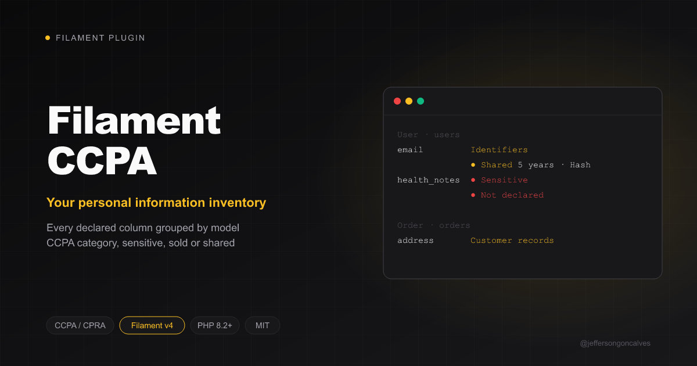

<div class="filament-hidden">



</div>

# Filament CCPA

[](https://packagist.org/packages/jeffersongoncalves/filament-ccpa)
[](https://github.com/jeffersongoncalves/filament-ccpa/actions?query=workflow%3Atests+branch%3A2.x)
[](https://github.com/jeffersongoncalves/filament-ccpa/actions?query=workflow%3A"Fix+PHP+code+styling"+branch%3A2.x)
[](https://packagist.org/packages/jeffersongoncalves/filament-ccpa)
[](LICENSE.md)

A personal data inventory page for your Filament panel, built on [laravel-ccpa](https://github.com/jeffersongoncalves/laravel-ccpa). It lists every column you declared with `#[PersonalData]`, grouped by model, with its category, purpose, legal basis, retention and anonymization strategy. It is what your CCPA notices disclose: the categories you collect, the sensitive ones, and what you sell or share.

## Features

- One card per model in `ccpa.models`, one row per declared column.
- Sensitive personal information highlighted, and columns you sell or share flagged.
- Columns without a CCPA category (Cal. Civ. Code §1798.140(v)) flagged as "Not declared".
- 19 languages.

## Compatibility

| Plugin Version                                                      | Filament |
|---------------------------------------------------------------------|----------|
| [1.x](https://github.com/jeffersongoncalves/filament-ccpa/tree/1.x) | 3.x      |
| [2.x](https://github.com/jeffersongoncalves/filament-ccpa/tree/2.x) | 4.x      |
| [3.x](https://github.com/jeffersongoncalves/filament-ccpa/tree/3.x) | 5.x      |

## Installation

You can install the package via composer:

```bash
composer require jeffersongoncalves/filament-ccpa:"^2.0"
```

Declare your personal data and register the models as described in [laravel-ccpa](https://github.com/jeffersongoncalves/laravel-ccpa#usage).

## Usage

```php
use JeffersonGoncalves\Filament\Ccpa\CcpaPlugin;

public function panel(Panel $panel): Panel
{
    return $panel
        ->plugins([
            CcpaPlugin::make()
                ->navigationGroup('CCPA')             // default: no group
                ->navigationSort(1)
                ->navigationIcon('heroicon-o-finger-print')
                ->slug('personal-data-inventory'),
        ]);
}
```

All fluent methods are optional. The page is read-only: the inventory lives in your code, next to the models.

> The page has no authorization of its own: register it only on panels whose users may see it, or override `canAccess()` in a subclass.

## Related plugins

- [filament-ccpa-requests](https://github.com/jeffersongoncalves/filament-ccpa-requests): consumer requests to know, delete and correct.

## Testing

```bash
composer test
```

## Changelog

Please see [CHANGELOG](CHANGELOG.md) for more information on what has changed recently.

## Contributing

Please see [CONTRIBUTING](.github/CONTRIBUTING.md) for details.

## Security Vulnerabilities

Please review [our security policy](../../security/policy) on how to report security vulnerabilities.

## Credits

- [Jefferson Gonçalves](https://github.com/jeffersongoncalves)
- [All Contributors](../../contributors)

## License

The MIT License (MIT). Please see [License File](LICENSE.md) for more information.
